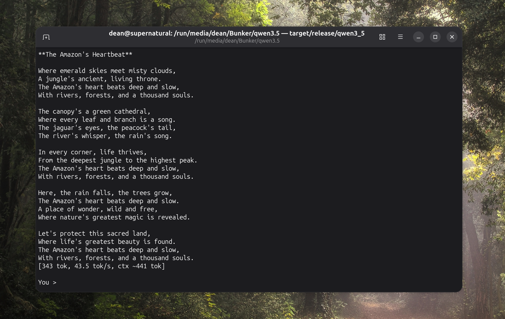

# A Rust inference engine for Qwen 3.5 with custom CubeCL kernels

Local inference for the **Qwen3.5 2B** text model, written from scratch in Rust on top of
[Burn](https://github.com/tracel-ai/burn) and [CubeCL](https://github.com/tracel-ai/cubecl),
running on the GPU through `wgpu`.

```bash
cargo run --release
```

The default Burn decode path ran this model at **~11 tok/s**. After
replacing the per-token projections with custom Q8F CubeCL kernels, the same weights and the
same GPU run at **~43 tok/s** (a **390% speedup**).



## Benchmark

| Decode path | Throughput | Relative |
| --- | --- | --- |
| Default Burn ops | ~11 tok/s | 1.0× |
| **Custom Q8F CubeCL kernels (this repo)** | **~43 tok/s** | **~3.9×** |

- **Decode-only**: the timer starts *after* prefill, so prompt processing is not counted.
- Greedy sampling (`argmax`), batch size 1, single stream.

Measured on: Linux, **NVIDIA RTX 4060 Ti** via `wgpu`.

## Q8F quantization

Weights are stored **8-bit, per-block-64, symmetric, with f32 scales** using Burn's
`QuantScheme::per_block([64], ScaleDtype::F32).with_value(QuantValue::Q8F)`:

## Generating `model.bpk`

Quantization is a one-shot offline step. Download the tokenizer and model safetensors from [Hugging Face](https://huggingface.co/Qwen/Qwen3.5-2B). In [`src/main.rs`](src/main.rs) swap the entry point:

```rust
fn main() {
    _quantize_and_save();  // instead of chat()
    // chat();
}
```
Then run `cargo run --release` with the original `model.safetensors-00001-of-00001.safetensors`
in the working directory.

## Run

```bash
cargo run --release
```


## License

The inference code is under MIT license and model weights are Apache 2.0 licensed.